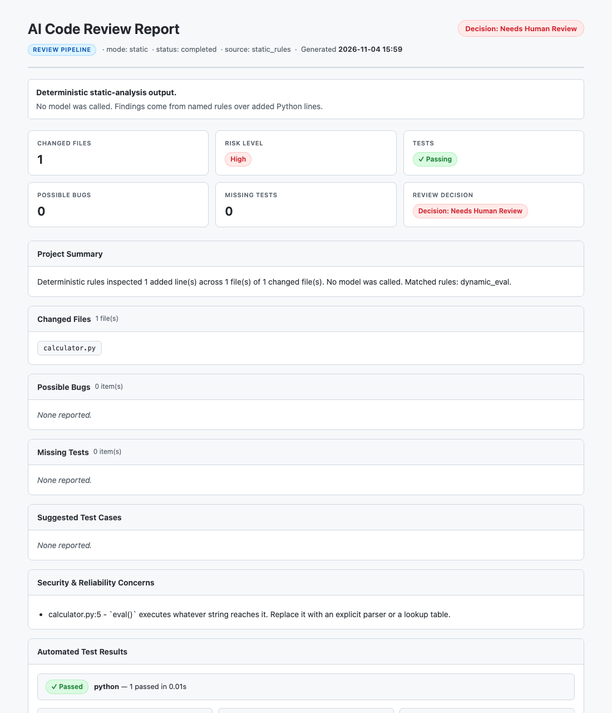

# Python diff review


A Git diff marks edited lines as new, even when the risky code was already there.

This CLI reviews small Python diffs from a working tree or a pair of commits. It applies named rules or an optional OpenAI reviewer, checks file and line references, and combines the result with the checkout's test output. The HTML report keeps proposed findings and grounding rejections together for a developer to inspect.

Personal project. Built with AI assistance.

[Run locally](#run-locally) · [Docs](#docs)



A static run on the latest documentation change, with the checkout path shortened:

```text
Review status: no_changes (mode=static, source=none)
Review report generated: <repo>/reports/review.html
```

## How it works

1. [git_diff_reader.py](backend/app/git_diff_reader.py) reads a working-tree diff or an explicit commit range.
2. [test_runner.py](backend/app/test_runner.py) detects and runs the checkout's Python, Node.js, or .NET test command.
3. [static_review.py](backend/app/static_review.py) applies Python rules; [llm_reviewer.py](backend/app/llm_reviewer.py) selects the rule or provider path and derives risk.
4. [finding_grounding.py](backend/app/finding_grounding.py) checks proposed findings against the diff and records rejection reasons.
5. [main.py](backend/app/main.py) combines review status and test results; [report_generator.py](backend/app/report_generator.py) renders the report.

Static rules compare added constructs with removed code in the same change block to avoid reporting an existing pattern again. Optional GitHub payloads pass through a separate line-anchor check before an inline comment can be posted.

| What goes wrong | What happens | Test |
| --- | --- | --- |
| An edit touches an existing risky pattern | The rule compares the removed code before reporting it | [Static rules](tests/test_static_review.py) |
| A proposal cites a line outside the diff | Grounding rejects it and keeps the reason | [Grounding](tests/test_finding_grounding.py) |
| Provider configuration or output fails | The CLI records the failure and returns exit 2 | [CLI statuses](tests/test_main_status_matrix.py) |

## Project layout

| Path | What | Start here |
| --- | --- | --- |
| `backend/app/` | Diff reader, rules, provider adapter, report generation | [main.py](backend/app/main.py) |
| `backend/templates/` | HTML report layout | [report.html](backend/templates/report.html) |
| `tests/` | Pipeline and GitHub adapter behavior | [test_static_review.py](tests/test_static_review.py) |
| `evals/` | Synthetic cases and real-diff measurement tools | [Guide](evals/README.md) |
| `docs/` | Architecture, commands, and data handling | [Reference](docs/REFERENCE.md) |
| `devlog/` | Development records | [Index](devlog/README.md) |

## Run locally

Requires Git and Python 3.11+. The demo uses static mode and needs no API key.

```bash
git clone https://github.com/yy31104/ai-code-review-qa.git
```

```bash
cd ai-code-review-qa
```

```bash
python3 -m venv .venv
```

```bash
source .venv/bin/activate
```

```bash
python -m pip install -r backend/requirements.txt
```

Review the latest commit and open `reports/review.html` in a browser:

```bash
AI_REVIEW_MODE=static python backend/app/main.py --repo . --base HEAD~1 --head HEAD --output reports/review.html
```

Tests and offline checks take a few seconds locally:

```bash
python -m pytest -q
```

```bash
python evals/run_local.py --out reports/evals/results.json
```

```bash
python evals/render_report.py --in reports/evals/results.json --md reports/evals/summary.md --html reports/evals/summary.html
```

Provider setup, working-tree review, and GitHub payload commands are in the [reference](docs/REFERENCE.md).

## Design notes

Lexical rules keep static review local and repeatable. Comparing removed and added constructs reduces comments about code that a change merely touched; the tradeoff is narrower detection within a change block.

The provider supplies proposed findings. The pipeline owns schema validation, grounding, test results, risk, and the final review status, so the report shows where each result came from.

GitHub writes use opt-in workflow gates. Report generation and comment payload construction can be inspected locally before those gates are enabled.

## Limits

- Rules cover Python patterns with lexical matching. Cross-file moves and same-block attribution can cause false positives or missed findings; grounding checks references, and a person judges correctness.
- Real-diff precision, recall, and provider quality remain unmeasured on a held-out human-labeled dataset. Confidence values are heuristic; development-pass results are in [devlog](devlog/REAL_DIFF_NOTES.md).
- Run against trusted checkouts: the CLI executes their detected tests on the host. Provider mode sends filenames and a character-limited diff to OpenAI; see [data handling](docs/DATA_HANDLING.md).

## Docs

- [CLI reference and rule inventory](docs/REFERENCE.md)
- [Architecture](docs/ARCHITECTURE.md)
- [Evaluation guide](evals/README.md)
- [Data handling](docs/DATA_HANDLING.md)
- [Security policy](docs/SECURITY.md)
